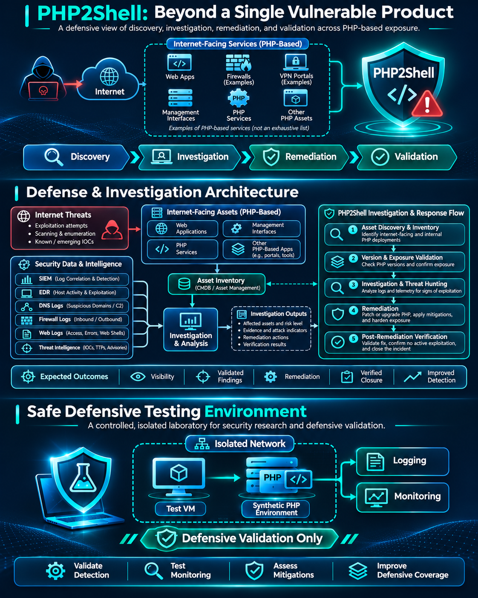
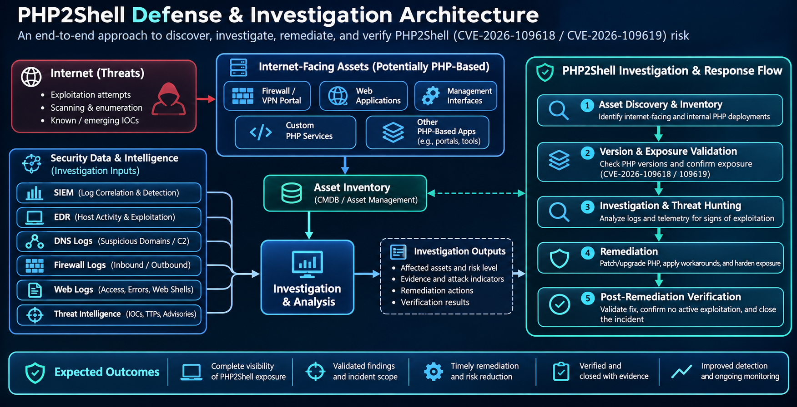
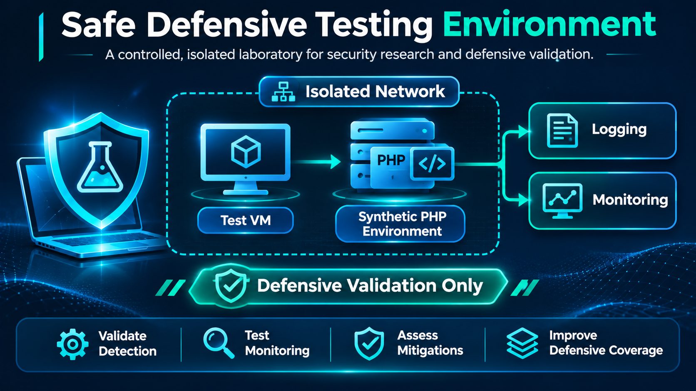

# PHP2Shell: Enterprise-Wide Exposure, Investigation, and Defensive Validation

> **Defensive, educational resource.** This repo has no exploit code, payloads, or scanning against live targets. The figures are conceptual illustrations, the sample assets are fictional, and it describes no employer, client, or production environment.



*Figure 1. Conceptual overview. The firewall and VPN icons stand for product categories that matter **only where they embed an affected PHP runtime**. They do not mean any particular firewall or VPN product is affected.*

## Quick start

```bash
git clone https://github.com/donxud/PHP2Shell-Security-Investigation.git
cd PHP2Shell-Security-Investigation
python3 triage.py assets.csv        # offline, version-only triage of fictional sample data
python3 -m unittest test_triage.py  # run the tests
```

## Executive summary

PHP2Shell is the name for two critical vulnerabilities in the PHP engine, **CVE-2026-109618** (out-of-memory corruption) and **CVE-2026-109619** (stale global state / use-after-free). Under vulnerable conditions they can allow unauthenticated remote code execution as the web worker account. The PHP project released fixes on 21 October 2026.

The flaw is in the runtime, not in a single application, so the exposure is **not limited to one CMS, firewall, or vendor**. PHP runs in websites, management interfaces, vendor appliances, internal applications, container images, and third-party software. This repository turns that point into a practical blue-team playbook: inventory, investigate, remediate, verify.

## 1. Advisory facts

| Field | Detail |
|---|---|
| Name | PHP2Shell |
| CVEs | CVE-2026-109618, CVE-2026-109619 |
| PHP advisories | GHSA-w8hw-w9fx-j79w (109618), GHSA-6wmf-4rv5-p3rp (109619) |
| Severity | Critical, CVSS v4.0 9.2 for each (PHP as CNA) |
| Impact | Unauthenticated RCE in the context of the PHP worker, under vulnerable conditions |
| Affected | 8.2 < 8.2.35, 8.3 < 8.3.36, 8.4 < 8.4.27, 8.5 < 8.5.12 |
| Fixed releases | 8.2.35, 8.3.36, 8.4.27, 8.5.12 (21 Oct 2026), or a distro/vendor build that carries the fix |
| End-of-life branches | 8.1, 8.0, 7.4 get no official release. Upgrade to a supported branch or use a vendor backport |
| Exploitation | Both CVE-2026-109618 and CVE-2026-109619 were added to the CISA Known Exploited Vulnerabilities catalog on 26 Oct 2026. Check the catalog for current status |
| Mitigation | PHP states that updating is the only complete fix. There is no generic configuration workaround |
| Priority | Internet-facing PHP first, then reachable internal and bundled PHP runtimes |

Always confirm against the upstream advisories and your vendor's package notices before planning changes. Distro packages often keep an older upstream version number and add the fix as a backport.

## 2. Think in layers: where PHP may be hiding

```text
Internet / internal clients
        |
        v
Reverse proxy / WAF / load balancer
        |
        v
Web server or admin endpoint (Apache, Nginx, etc.)
        |
        v
PHP execution path (mod_php / PHP-FPM / CGI / FrankenPHP / LiteSpeed / embedded runtime)
        |
        v
Application / CMS / third-party extension
        |
        v
OS / container / storage / downstream identities and services
```

An inventory that lists only web application names will miss PHP binaries, PHP-FPM pools, vendor packages, base images, and runtimes bundled inside appliances.

For each asset, record at least: owner, criticality, external/internal reachability, PHP version and build, SAPI, OS or container image, package source, applicable vendor advisory, compensating controls, and verified remediation status.

### Checking the runtime that actually serves requests

The CLI version can differ from the version serving web traffic. These read-only commands help on hosts you are authorized to administer:

```bash
php -v                                   # CLI binary only
php-fpm -v  ||  ls /usr/sbin/php-fpm*    # FPM binary (name varies by distro)
apachectl -M 2>/dev/null | grep -i php   # is mod_php loaded?
dpkg -l | grep -E '^ii\s+php'            # Debian/Ubuntu package versions
rpm -qa | grep -i '^php'                 # RHEL/Fedora/Amazon Linux package versions
```

For containers, check the base image tag and rebuild date as well as the PHP version inside it.

## 3. Understand potential impact without assuming compromise

Illustrative consequences **if** an attack path succeeds:

1. Code execution with the privileges of the affected PHP worker.
2. Exposure of secrets and application configuration readable by that worker.
3. Web-shell placement or persistence, **if** the worker can write to suitable locations.
4. Data access or modification, **if** the runtime identity permits it.
5. Lateral movement into connected internal services.

These are possible outcomes, **not proof that any given vulnerable installation was compromised**. Exploitability, privileges gained, and follow-on access depend on the deployment. Large-scale automated scanning for vulnerable hosts started within hours of disclosure, so treat unpatched internet-facing assets as likely to have been probed.



*Figure 2. Generic visibility and investigation workflow. The arrows show an analytical process, not connectivity in a real network.*

## 4. Investigation and hunting checklist

### A. Scope and prioritize

- Identify externally reachable web services and administrative interfaces.
- Inventory PHP binaries, installed packages, running PHP-FPM processes, loaded Apache PHP modules, and image/package manifests.
- Ask appliance and software vendors whether their products bundle PHP, and which fixed builds they support.
- Keep four states separate: vulnerable version, exploitable configuration, suspicious activity, confirmed compromise.

### B. Collect available telemetry

- Web access, reverse-proxy/WAF, web-server error, and PHP logs. Pay attention to unusual multipart/upload requests and worker crashes or out-of-memory errors around and after 21 Oct 2026.
- EDR process telemetry: a web server or PHP worker spawning shells, downloaders, or system utilities.
- File integrity changes in web roots, upload paths, temp directories, startup locations, and scheduled tasks.
- Network/DNS telemetry: unexpected outbound connections from server identities.
- IAM, secret-store, SSH, API, and database access logs tied to the affected host.

### C. Investigate evidence, not just indicators

- Normalize timestamps across sources and build a timeline.
- Preserve logs and forensic artifacts before destructive remediation, when it is practical and safe.
- Use verified vendor and government threat intelligence alongside internal telemetry.
- Correlate process, network, filesystem, and authentication evidence.
- If compromise is established, scope persistence, downstream access, and data access. Record confidence and gaps.

## 5. Remediation: verify the *effective* fix

1. Confirm who distributes and maintains PHP for each asset: OS package, source build, container, vendor appliance, or managed service.
2. Obtain the fixed release or the vendor's documented backported package.
3. Schedule urgent changes by exposure and service criticality.
4. Apply the update and **restart** PHP-FPM pools, Apache, or other long-running workers. A patched binary on disk does not help until the running processes are replaced.
5. Verify the **runtime serving web requests**, not only the CLI binary or the application version.
6. Recheck exposure, application health, logs, and detection coverage after the change.
7. Where compromise is plausible, finish the retrospective investigation and rotate credentials the worker could read.

Temporary mitigations and WAF rules may reduce exposure but do not replace patching.

## 6. Safe sandbox: offline inventory triage (no exploitation)



*Figure 3. Example isolated-lab design. It is not evidence that a vulnerable test host was deployed. The script below performs inventory triage only.*

`triage.py` reads a local CSV and compares each PHP version with the fixed upstream releases. It makes no network requests, sends no payloads, and does not test exploitability.

```csv
asset,php_version,exposure,package_source
internal-app-02,8.3.36,internal,upstream
public-web-01,8.4.26,internet,upstream
legacy-vendor-03,8.2.34,internal,vendor-backport
distro-web-05,8.4.27-1~deb13u1,internet,distro
legacy-portal-06,8.1.31,internet,upstream
workstation-04,,internal,unknown
```

```bash
python3 triage.py assets.csv
```

Output, with internet-facing assets listed first:

```text
[internet] public-web-01: UPDATE
[internet] distro-web-05: MANUAL REVIEW: verify distro/vendor package advisory
[internet] legacy-portal-06: UPDATE: end-of-life branch, no upstream fix
[internal] internal-app-02: MEETS LISTED UPSTREAM FIX
[internal] legacy-vendor-03: MANUAL REVIEW: verify distro/vendor package advisory
[internal] workstation-04: MANUAL REVIEW: missing/nonstandard version
```

The script exits with status `1` when any asset needs action or review, so it can gate a CI job or a scheduled check.

**Limitations:** It trusts the inventory you give it. It does not assess reachability, SAPI configuration, distro/vendor backports (those are flagged for manual review), image provenance, or compromise. Treat its output as a first triage hint, not proof of a working patch or a clean host.

**Do not commit real data.** Never put real asset names, IP addresses, credentials, tokens, logs, screenshots, or investigation notes in a public repository. The included `.gitignore` excludes `*.real.csv`, `inventory/`, and `private/` as a safety net. Run real analysis only in an approved private environment.

## 7. Make the response repeatable

Maintain a living dependency and exposure inventory. Subscribe to upstream and supplier advisories. Test detections and alert routing, document playbooks, review least privilege and credential boundaries, and run tabletop exercises. A vulnerability-response program works when teams know *what is running, who owns it, how to confirm exposure, how to act safely, and how to verify recovery*.

## Repository layout

```text
.
├── README.md
├── LICENSE
├── .gitignore
├── assets.csv          # fictional assets only
├── triage.py           # offline, version-only triage
├── test_triage.py      # unit tests for triage.py
└── assets/
    ├── php2shell-overview.png
    ├── defense-investigation-architecture.png
    └── safe-defensive-sandbox.png
```

## References

- [PHP Foundation: security release and security process, 21 Oct 2026](https://thephp.foundation/blog/2026/10/21/todays-php-security-release-and-how-were-strengthening-php-security/)
- [PHP release archive: 21 Oct 2026 security updates](https://www.php.net/archive/2026.php#2026-10-21-5)
- [oss-security: CVE-2026-109618 announcement](https://openwall.com/lists/oss-security/2026/10/21/6)
- [oss-security: CVE-2026-109619 announcement](https://openwall.com/lists/oss-security/2026/10/21/7)
- [CISA Known Exploited Vulnerabilities catalog](https://www.cisa.gov/known-exploited-vulnerabilities-catalog)
- [NCSC-NL PHP2Shell operational information](https://github.com/NCSC-NL/php2shell)
- [Singapore Cyber Security Agency advisory, updated 23 Oct 2026](https://www.csa.gov.sg/alerts-and-advisories/alerts/al-2026-151/)
- [Palo Alto Networks Unit 42: PHP2Shell threat brief](https://unit42.paloaltonetworks.com/cve-2026-109618-cve-2026-109619/)

## License

Code is released under the [MIT License](LICENSE). Facts and advisory details belong to their original sources. Check those sources before operational use.
